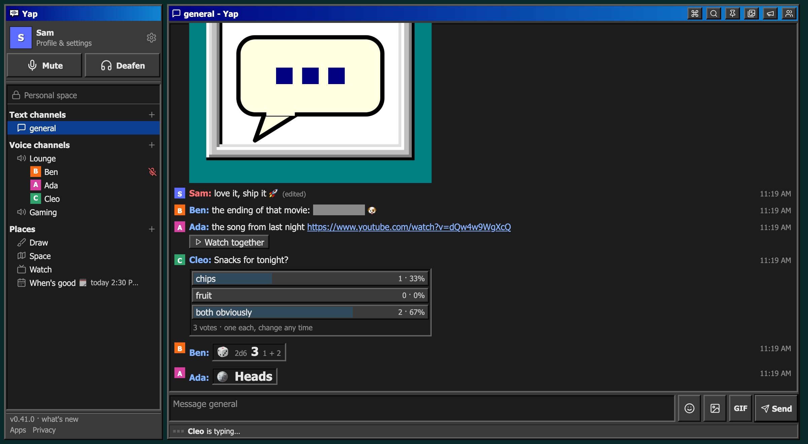

# Yap

<picture>
  <source media="(prefers-color-scheme: light)" srcset="docs/screenshot-light.png">
  
</picture>

A small, calm Discord for one group of friends: **text channels and voice
channels**, plus a few extras. You run it yourself, for free, on Cloudflare.
Voice goes straight between friends as high-quality Opus, so it sounds better
than most chat apps and costs nothing to run.

> **Yap was built for one friend group and is shared as is.** You're welcome
> to run your own copy and change it, but there's no support: issues and
> requests may go unanswered.

## What makes it different

- **No presence.** No online dots, no "last seen", no read receipts. People
  only see you in a voice channel or on a shared place.
- **Deleting a message erases it** from the server.
- **No ads, analytics or tracking.** Your server is yours, and so is the data.
- **Nothing to keep you hooked:** no streaks, badges or "you've been away"
  nags, and quiet hours at night.
- **Light:** a web app with no framework, and native apps instead of
  Electron.

## What's in it

- **Chat:** channels, replies, reactions (and tiny doodle reactions),
  @mentions, pins, search, GIFs, pictures, custom emojis, polls, `/roll` and
  `/flip`, spoilers and edits.
- **Voice:** peer-to-peer calls at 128 kbps by default (up to Opus's 510).
  Each packet also carries the one before it, so choppy Wi‑Fi doesn't make
  voices robotic.
  - Noise suppression (RNNoise, the same AI filter in the browser and the desktop app), echo cancellation, push-to-talk and per-person volume.
  - Screen sharing with sound, a soundboard with a loudness cap, and join
    chimes.
  - A call report you can copy when a call sounded off.
- **Places** next to the chat, so the call keeps going:
  - **Draw**, a shared board with layers;
  - **Space**, a little top-down world where rooms are voice zones;
  - **Watch together** for YouTube;
  - **When's good**, a weekly planner with reminders.
- **Personal space:** notes only you can see, optionally end-to-end encrypted
  with a passcode.
- **Accounts that fit friends:**
  - an invite link is the door, and newcomers wait until the owner or a mod lets them in;
  - an account is a name and a password;
  - sign-in alerts, a device list, and an owner with mods.
- **One look:** Windows 98 / AIM, in light or dark.

## Apps

- **Web:** any modern browser. It can be added to a phone's Home Screen.
- **Desktop:** a native Rust app for Windows, macOS and Linux, with global
  push-to-talk. Your server hosts the downloads and its signed updates
  (`desktop/README.md`).
- **iPhone, iPad and Mac:** a SwiftUI app. Build it with your own Apple
  developer account (`apple/README.md`).

## Run your own

You need a free Cloudflare account and Node.js. It takes about ten minutes:
[SELF_HOSTING.md](SELF_HOSTING.md). Then send your friends the invite link.

Voice is a mesh, with each person connected to everyone else in the call, so
one call suits up to about eight people.

## How it works

- **Server:** one Cloudflare Worker with SQLite-backed Durable Objects
  (`worker/`). It's the whole backend: accounts, history, and signaling for
  voice.
- **Web client:** plain JavaScript and CSS (`web/`), with no framework and no
  build step.
- **Desktop:** Rust and egui (`desktop/`). **iPhone/Mac:** SwiftUI (`apple/`).
- **Voice:** WebRTC, straight between people, so audio never touches the
  server. That's what keeps it free.

[PROTOCOL.md](PROTOCOL.md) describes the wire protocol every client speaks.
[SECURITY.md](SECURITY.md) explains what protects what, in plain words.
[PHILOSOPHY.md](PHILOSOPHY.md) explains what Yap is and refuses to become.

## Developing

```sh
npm install
npm run test:all     # every test, on a test server of its own
# A local server with the test settings. NTFY_SERVER keeps its phone pushes
# on this machine (where the protocol test's fake ntfy listens), never on
# ntfy.sh; TEST_HANGS lets a hang start a second from now.
npm run dev:test -- --port 8787 --persist-to .wrangler/dev-test \
  --var NTFY_SERVER:http://127.0.0.1:8790 --var TEST_HANGS:1
```

Open http://localhost:8787/#key=testkey. The first person to sign up becomes
the owner. For `npm run dev` (with your own `wrangler.jsonc`), copy
`.dev.vars.example` to `.dev.vars` first. `CLAUDE.md` has the full list of
commands, conventions and design decisions, written for both people and
coding agents.

## License

Yap is free software under the [GNU Affero General Public License v3.0](LICENSE).
You can use it, change it and run it for anyone. If you run a changed version
for other people, you have to offer them your changed source code. Set
`SOURCE_URL` and the app's Source link will point to it.

Copyright © 2026 the Yap authors.
